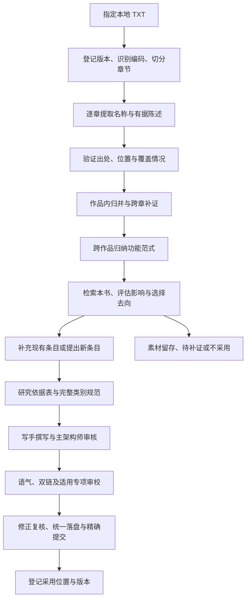

# 经典网文素材采集与转化流程设计

版本：v0.2；更新：2026-10-21。本文保留总体设计；当前已实现来源登记、切章、章节导出、有据 JSON 导入、位置校验、人工语义复核登记与来源隔离报告。真实模型调用、自动调度、完整准入及采用记录尚未实现。实际命令与限制以同目录 `README.md` 为准，不能将下文规划视为已交付能力。

## 1. 目标与交付边界

从用户指定的本地经典网文 TXT 按章节提取草木、丹药、法术、器物及关联材料，积累可追溯的素材，再择优融入赤血世界。闲余额度用于持续采集、补证据和审校；有效采用量与设定质量优先于调用量。

设计边界为不读取未指定的外部 TXT、不启动常驻任务、不自动新增正式设定。首版聚焦草木、丹药、日用与低阶术法、百艺器具；高阶灵宝可以记录，但不默认属于低影响素材。

依照根 `AGENTS.md`，素材记录不等于正式设定。正式创作仍完整执行检索、撰写、审校、交付四阶段，由 `style-writer` 唯一负责初稿正文，主架构师统一整合修订。

## 2. 总体流程

前段可以并行采集，后段小批转化。不得从“出处验证通过”直接跳至正式入库。

## 3. 文件与职责分离

| 位置 | 内容 | 管理方式 |
| --- | --- | --- |
| 用户指定的书库目录 | 原始 TXT | 只读，不擅自改名或覆盖 |
| `.workbench/novel_mining/` | 规范化文本、章节、数据库、候选、报告及任务日志 | 本地工作数据，沿用已有忽略规则，不进入正式双链目标 |
| `scripts/novel_mining/` | 设计、未来协议、提示模板及使用说明 | 纳入 Git；当前仅有本设计 |
| `scripts/novel_mining.py` | 未来离线命令入口 | 规划路径，当前不存在 |
| `世界/`、`角色/`、`故事/` | 审校通过后的正式内容 | 仅由主架构师按创作管线整合 |

建议首版使用 SQLite 保存来源、任务、陈述、实体与采用关系，以事务保证恢复和归并一致性；JSONL 用于代理输入输出交换，Markdown 用于人工检查。不要同时把数据库和导出文件当作两个可独立编辑的真源。

书库路径由本地配置指定；共享配置和报告不暴露用户绝对路径。TXT、长摘录和包含原文的素材数据不随项目公开发布；原创转化稿与必要审计说明另行管理。本地工作数据需有独立备份，Git 忽略不等于已经备份。

## 4. 来源登记与章节切分

1. 登记作品、作者（未知可空）、本地版本标签、原始字节 SHA-256、文件大小和指定编码。
2. 优先尝试 UTF-8/BOM；失败后明确尝试兼容编码，不能用替换乱码的方式继续处理。存在歧义时抽样确认后登记。
3. 保留原文件，生成 UTF-8 规范化文本及其哈希，记录规范化规则版本。广告和重复章节先标记，不无痕删除；清洗与原文的映射须可回查。
4. 按标题模式识别卷、章、序章与番外，生成内部顺序号。原章号和章名保留，重复章号不能覆盖前章。
5. 检查过短章、异常长章、目录正文重复、明显缺章和无标题段落；异常进入人工复核，不把章号不连续一概认定为文本损坏。
6. 无法可靠切章时输出待确认清单，不能静默按固定字数切段后声称已逐章覆盖。

章节 ID 绑定作品版本、切分版本和内部序号。证据定位使用规范化章节内 Unicode 码点偏移，0 起始、左闭右开；同时记录章节哈希与短证据片段。行号仅供显示，不能替代稳定定位。原 TXT 更新时建立新来源版本，不复用旧位置。

## 5. 逐章提取协议

章节是覆盖与进度单位。初始每任务一章；超长章节分块，记录重叠范围及块 ID，所有块完成后才算章节完成。短章合批作为后续优化，每章仍有独立结果。上下文片段必须标明所属章，不得把邻章陈述归到本章。

| 对象 | 必备字段 |
| --- | --- |
| 任务 | `task_id`、阶段、作品版本、章节/块 ID、输入哈希、提示与协议版本、状态、尝试次数 |
| 名称出现 | `mention_id`、原名、别名、类别、名称证据位置；允许只有名字而无功能 |
| 有据陈述 | `claim_id`、对象、属性、归纳值、证据位置、陈述类型、适用条件、说话者（适用时） |
| 素材实体 | `entity_id`、作品内名称集合、出现记录、陈述集合、未明事项及冲突集合 |
| 功能范式 | `archetype_id`、功能摘要、相关实体、共性、差异及依据陈述 ID |
| 转化候选 | `candidate_id`、来源实体/范式 ID、本书匹配、去向、影响评估、拟新增内容、依据快照 |
| 采用记录 | 候选 ID、最终文件、提交哈希、适用审校报告、最终正文哈希 |

提取字段包括用途、材料或配方、产地与生态、操作条件、境界限制、代价、副作用、失效条件、保存炮制及交易线索。只提取有据字段，未知保留空值和原因；没有记载代价不等于没有代价。

陈述类型至少区分旁白说明、情节实际展示、人物说法、传闻及否定/假设。实际展示只支持当次条件下的效果，不能自动升格为普遍法则；人物自述也不能自动成为事实。

每个非空事实字段必须关联至少一条可定位证据。名称匹配、片段匹配和哈希检查可由工具完成；证据是否支持归纳仍需语义复核。原文或模型输出里的操作指令均当作数据，不获文件写入、命令执行或修改规则的权限。

输出明确列出已检查类别和“未发现”结果，禁止为满足数量补造素材。模型自评置信度仅作复核排序，不当作准确率或准入证据。

## 6. 归并、矛盾与补证

- 作品内：名称规范化只生成匹配提示，不篡改显示原名。同名不一定同物，别名也须有证据；不确定关系保留为待归并。
- 跨章节：新增陈述追加到实体，不能用后章内容直接覆盖早期记载。升级、地域变体、人物误判与真实矛盾分别标注。
- 跨作品：实体保持独立，只建立功能范式关联；相同名字不能合并配方、威力、等级或价格。
- 重复任务：任务键包含输入哈希、阶段和协议/提示版本；有效完成结果不重复调用。相同证据重复返回时按稳定键归并，保留尝试日志。
- 有效陈述冲突：记录双方证据及条件，交研究代理回读定向上下文，不能由程序选择“较新”或“更强”的说法。
- 后续更新：来源新增记载只更新素材层；已采用条目生成影响复核任务，不静默重写正式内容。

## 7. 本书检索与设定准入

研究代理执行目标名称、类别/别名、功能及上下游三轮检索，读取实际命中文章，区分既成事实与本次拟补完。无直接依据时明确标注“现有仓库缺少直接依据”，采用最小假设；不能将外部来源当作本书事实。

每条候选逐项评估：境界上限、形意与业等代价、可量产程度、资源与价格、战斗和侦测平衡、空间/时间能力、寿命与复活、时代/地理/势力条件。用途普通不代表普及后影响小；价格缺证时不能宣称廉价普及。

| 分流 | 判断与动作 |
| --- | --- |
| 优先转化 | 功能局部、边界清楚、与已核定规则相容；例如保存炮制、日用百艺，但仍逐项核验 |
| 专项评估 | 储物、隐匿、侦测、飞行、回灵、强化、量产或跨境界效果；补足机制与社会影响再决断 |
| 暂缓采用 | 牵连核心法理、无代价破境、无限资源、复活或未裁定口径；保留出处，不能自行改动主设定来迁就 |

触及核心法理完整加载 `世界/背景/AGENTS.md`；涉及神族起源再加载 `世界/势力/神族/AGENTS.md`。`scripts/world_constraints/` 仅用于检索提示和人工审阅，按来源哈希回读证据，不是自动判错或准入引擎。

主架构师给出四种去向：补充现有条目、提出新条目、仅留场景素材、不采用。历史/法理/跨文关联与展开价值不足的素材不得逐个独立建档。丹药、阵法暂按功能检索实际承载条目并拟定归档位置，不凭类别名新建目录。

已核实的类别要求：草木须交代水土、性味、采制与生态代价；器物须体现文明、时代、用途及反噬，已有六阶承接体系，外书品阶不能直接换算；法术须交代媒介、术源、起势施展收势及反噬。草木和器物须区分九州与神族来源。具体转化仍以完整规范和关联正文为准，不用这些摘要代替依据表。

拟转化方案记录保留的通用功能、舍弃的原作专属机制、本书生态与成本、本次原创补完、受影响文件及拟回填内容。成熟通用名称优先；原作专属名称与标志性设定不得仅靠换名照搬。所有本书补完与来源事实分字段保存。

## 8. 创作调度与入库

1. `research-agent` 交付完整依据表、目标目录类别规范全文及适用专项规范；主架构师审核四项核心设问。
2. 仅在用户要求或存在具体创作难题时启用 `character-actor` 预演；人数和重要对白本身不触发。茶馆回目先由 `teahouse-chronicler` 完成阶段一增补。日常取材分析、工具开发与流程维护由主代理直接完成。
3. `style-writer` 独立撰写正式初稿；候选阶段草稿放本地工作区。主架构师审核后安排审校，审校所用文件列表与内容哈希固定。
4. `tone-checker` 与 `crosslink-checker` 可并行，仅出报告。主架构师落实修订；涉及人物条目或重要人物交锋再由 `character-reviewer` 复核，人物建档或重修同步交付 MD/JSON。
5. 同一体系或核心概念涉及至少三个文件，或属于批量扩写/跨卷统稿时，在前述修正落定后由 `worldbuilding-consistency` 统筹审校；回填文件也计入范围。
6. 严重、中等问题清零；需复核事项逐条裁定；最终文件相对审校快照有实质变动时，重跑受影响审校，不能沿用过期通过记录。
7. 主架构师统一落盘，检查格式、双链、回填、人物底谱和文件归属；只暂存本批实际改动，中文提交说明写明原因、范围和验证，提交并推送当前分支远端。
8. 提交成功后登记采用关系。推送失败单独标为待推送，保留本地提交；不重复生成内容、不改写历史、不把本地提交声称为已推送。

正式写入前持久化批次 ID、基线提交、目标文件原始/最终哈希、候选 ID 和提交意图；提交说明带批次 ID。恢复时核对 Git 中该批次提交及文件树，再补登记采用关系；已提交则只处理待登记或待推送，不再次生成提交。推送后核对远端目标提交；连接失败记为状态未知，先重查再重试。提交与 SQLite 不能组成一个原子事务，必须靠这份意图记录对账。

代理输入只携带当前阶段需要的资料，提取代理不加载整部书或全库正文。并行代理不直接修改正式文件；由单一协调者串行归并数据库和正式写入，避免状态覆盖。

协调者使用操作系统独占锁，第二个实例拒绝启动；数据库领取任务在事务中完成。每次租约有递增代次，返回结果须匹配当前代次、输入版本和任务状态，否则隔离为过期响应。整合正式文件前再次比较基线哈希；发现其他会话修改目标文件即暂停该批整合，重读并重新审校受影响内容，不覆盖他人改动。

## 9. 状态、恢复与预算

任务状态：`pending → running → succeeded`；失败进入 `retry_wait`，达到上限进入 `failed`。人工输入或来源不明进入 `needs_review`。每次尝试独立记日志；成功意味着该阶段输出通过验证，不表示素材已经采用。

候选状态：`captured → verified → consolidated → assessed → selected → drafted → reviewing → ready → committed`。补证使用 `needs_evidence`，冲突使用 `on_hold`，不采用使用 `rejected`；保存理由和前后状态事件。不得用“章节已处理”代替“候选已采用”。

| 事件 | 返回节点与责任 |
| --- | --- |
| 补证完成 | 研究代理补交证据，主架构师确认后回到 `verified`，重新归并和评估 |
| 冲突解除 | 主架构师登记裁定与依据，回到 `assessed`，不能直接放行成文 |
| 审校退回 | 主架构师修正后回到 `drafted`，再进入受影响审校；机制变化先回到 `assessed` |
| 仅留场景素材 | 进入 `reference_only`；以后选用时由主架构师重新开启 `assessed`，不视作已采用 |
| 来源/规则失效 | 保留原阶段历史完成记录，当前有效性置为 `stale`；从最早受影响节点复核，未完成前不得推进 |

任务和候选均分开保存流程状态与有效性（`current` / `stale`），`succeeded` 和 `committed` 只陈述历史事件；失效不能删除既有提交，也不能把历史通过当作当前有效。

`running` 使用任务租约与心跳，异常退出后核验结果再回收。响应先写临时文件，通过协议、证据与版本检查后在事务中登记成功；迟到响应和重复回调不得覆盖已接纳版本。输入、规则或本书相关来源变化时，保留历史结果并标为待复核，仅重跑受影响阶段。

初始建议值：采集并发 2、单任务一章、单轮最多 10 章或 30 分钟、失败最多尝试 3 次（含首次）、转化每批最多 5 条。均为待实测参数，不是吞吐承诺；单轮到界后完成或登记在途任务再退出，不继续领新任务。

预算同时记录任务数、耗时、输入输出字符；执行入口确实返回 token/额度数据时再记录，不把字符数称为 token。优先级为修复失败与补证、消化已选候选、继续采集；待评估候选达到本地上限（初值 100）暂停新章领取。

首版手动发起有限批次，不创建定时器。离线工具只组装任务和校验响应；模型执行接口单独适配并在后续验证认证、可用模型、计费/额度归属、限流和中断恢复。未验证前不承诺脚本能直接使用用户的 coding plan，也不自动改用付费 API。

P2 前先验证最小执行入口：可由当前会话人工调度真实代理，再导入响应，不要求先开发自动调用接口。每次领取任务前预留一次调用和输入/输出上限，失败和重试均计入本轮预算；未返回精确用量时采用保守预留，不按零计费。无法确认额度时禁用无人值守调用；人工有限批次按已确认入口及显式调用/时长上限执行。超时先请求取消，无法确认取消则保留在途预算并停止继续派发；其迟到结果按租约规则核验。

## 10. 分阶段实现与验收

| 阶段 | 交付物 | 通过条件 |
| --- | --- | --- |
| P0 来源与协议 | 来源清单、切章预览、素材/陈述/任务协议及小型原创测试文本 | 不改原文件；编码歧义、重复章号、序章番外和异常章节可查；定位可回读 |
| P1 离线采集闭环 | 登记、切章、任务包导出、响应导入、验证与进度报告 | 无模型也能以原创夹具验证断点恢复、无结果章、超长章、拒绝错证据与幂等 |
| P2 真实采集试点 | 最小执行入口与预算闸门、一本指定 TXT 连续约 30 章的素材卡与归并报告 | 执行归属已核实；每章/块均有状态，每项事实可定位；误提、漏提与错误归并有人工抽查记录并完成退回闭环 |
| P3 转化试点 | 最多 5 条有价值候选及适用创作审校报告 | 不足 5 条不凑数；采用的每条完成依据、正文、回填、审校及精确提交 |
| P4 有界持续运行 | 执行适配、预算控制、重试、备份与阶段报告 | 身份/额度归属已验证；中断可恢复、积压会限流、失败不自动写入正式设定 |

P2 建议人工抽查约 6 章，覆盖有结果、无结果、疑难和分块章节；不足时全查。只报告样本内误提和漏提，未逐章建立人工标注就不宣称全书召回率。所有准备采用的事实与来源需逐条复核。

试点放行条件：结构及位置核验全部通过，抽查中错证据、无据陈述、错误实体归并和已发现漏提全部修正。任何此类错误都退回对应提取/归并节点，并扩查至约 12 章；复验再出现同类错误则复核试点全部章节、修订提示或协议后重跑受影响任务。放行只表示试点达到这一抽查标准，不能宣称全批无漏提。P1/P4 故障演练须覆盖重复协调者、租约失效、迟到响应、预算中断，以及提交成功但尚未登记/推送的恢复窗口。

阶段报告列明：覆盖章节/块、待复核章节、名称数、有据陈述数、归并后实体数、冲突数、四种去向数量、实际采用数量、审校退回原因、运行消耗和未完成事项。不以素材条目总数单独判定成功。

验收重点是源文无损、证据不漂移、传闻不升级为事实、跨书不串设定、并发不覆盖、重试不重复入库、过期审校不放行、素材不污染正式双链。正式内容使用现有 `scripts/check_crossrefs.py` 检查双链目标及裸词；工具通过不能替代语义审校。

## 11. 下一步输入

开始 P0/P2 前，需要用户指定一本 TXT 的实际路径（或明确授权的书库目录）与优先作品。拿到文件后先出章节预览和编码检查，再锁定约 30 章试点范围。现在尚未验证书库位置、文本完整性、真实提取质量或执行吞吐。

下一轮先实现 P0/P1；通过离线验收后再接入真实章节采集。是否建立长期调度，在真实试点和执行入口验证后另行确定。

## 12. 已核实的工程依据

- 根 `AGENTS.md`：四阶段职责、真实 subagent、类别规范、独立建档、交叉引用、人物底谱及精确提交要求。
- `README.md`：正式内容集中在 `世界/`、`角色/`、`故事/`；场景层为策划输入，不能当作正式设定来源。
- `scripts/world_constraints/README.md`：约束卡是派生索引、需要人工语义审阅，目前无自动判错、激活或正式写回能力。
- `scripts/scene_runtime/PLAN.md`：可借鉴来源哈希、输入组装、候选与采纳分离；其场景工具不能直接视为 TXT 采集器。
- `scripts/check_crossrefs.py` 与 `.gitignore`：已有双链检查入口，`scripts/` 和 `.workbench/` 不进入正式内容扫描，`.workbench/` 已忽略于 Git。
- `世界/草木/AGENTS.md`、`世界/器物/AGENTS.md`、`世界/功法/法术/AGENTS.md`、`世界/背景/AGENTS.md`：类别生态、器物六阶、术法行法与形意实时对流等适用边界；研究代理已完成三轮有界检索，来源与类别约束作为本设计依据，不构成全库一致性结论。
