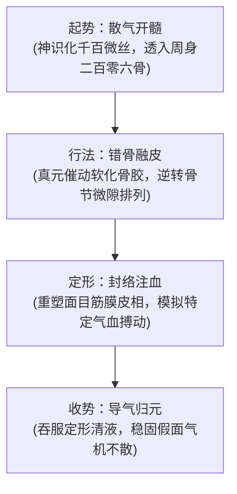

# 千面易容诀

#九州 #法术 #魔道 #形意 #易容

[[世界背景]] [[业]] [[修士境界]] [[州城法网]] [[修仙门阀]]

## 概述

在九州深山隐秘洞府与各大州城阴暗幽微的地下黑市之中，流传着一种被名门正派斥为“断骨戕生、惑世欺天”的偏门魔道奇术。修习此法者，不假任何金玉外物或凡俗涂脂，唯以至精至纯的神识驾驭细若游丝的暴烈真元，如无形刻刀般深入周身皮膜、骨节与髓海深处，强行移位骨骼、重塑肌理面目，甚至能在片刻之间将昂藏七尺壮汉化作伛偻老妪或弱冠少年。这门令各大州府刑名巡捕防不胜防的秘法，便是[[千面易容诀]]。

此法在九州道统谱系中属于罕见的“微观塑形魔功”。市井隐客亦称其为“天魔造化功”或“移骨神术”。在面对[[州城法网]]重重画影图形悬赏通缉、抑或遭受死敌宗门灭顶围剿的绝境之中，施术者忍受万蚁噬骨之奇痛催动法诀，将自身外在表象彻底改易，从容步入闹市之中与追兵擦肩而过。它不仅是一门改换皮囊的避祸机巧，更是九州修士试图以自身意志强行干涉肉身形质、撼动造化定序的极道尝试。

## 核心法则

### 意动形随
天地底层律乃是形脉与意脉的实时对流。寻常生灵形骸由先天精血底定，意随形转；此法反其道而行之，以极强之主观神意为主导，强行压制肉身固有的形脉记忆，令皮肉骨髓如融金化蜡般顺应意念重构。

### 微隙挪移
人体二百零六块骨节与周天经络之间，皆有微茫空隙。施术者并非折断骨骼，而是以真元渗入骨缝关节滑囊，微调各处骨节咬合尺度，聚缩则身形缩短，延展则体态魁伟。

### 气血同化
改换外貌最忌气机破绽。此法在重塑面皮之时，以真气模拟特定目标经脉的细微搏动与体温皮色，使外释之气血表象与真实生人一般无二，从而彻底欺瞒寻常照形法镜与神识探查。

## 法统与术源

溯其法统，此法起源于中古时代一位因面目丑陋而遭宗门弃逐的惊世魔修。该修者天资绝伦却生来畸形，尝尽人间冷眼与同侪凌辱，后在一处上古仙魔古战场残碑上参透“形意非永固、肉躯本无常”之至理，愤而开辟此功。

他以自身肉躯为鼎炉试验千百次，数度经络寸断险死还生，终大成出关。彼时其化身翩翩佳公子混入昔日仇家宗门，拜入宿敌座下潜伏三十载，直至晋升长老执掌戒律之日，方于万仙大会之上霍然蜕回本相，一举掀翻宗门法统，名震四方。后该修者被九州各大名门合力围杀于绝顶，其临终前将法诀刻于三枚带血玉简之中抛落红尘。历经数千年流转，法诀残篇辗转流入暗门刺客与江湖亡命之手，成为天下刺客与易容大盗竞相争夺的魔道秘宝。

## 施术原理与行法次第

行法过程极为残酷冷冽，犹如在自身活体之上施以凌迟。

行法初阶为“散气开髓”：施术者须闭关静室，屏除五蕴杂念，引丹田真气化为极细之气丝，顺十二正经逆流刺入周身骨节孔隙，真气如火烘烤骨胶，令原本坚不可摧的骨质渐趋松软温热；
中阶为“错骨融皮”：神识依照脑海中勾勒之目标面貌身材，精准调控气丝拉扯骨节位移。骨骼错动之间，周身传出如炒豆般的清脆噼啪爆响，伴随撕心裂肺之剧痛；皮下肌纤维与脂肪组织随之重新分布堆叠；
末阶为“定形锁脉”：以真元封死皮膜关键气窍，调理新面孔之毛细经络，使气血通畅如常。施术毕，面部如戴无形面具，触手温软有弹性，冷热自知，全无半点僵硬破绽。

## 入门条件与修持代价

### 适修之人
神识极其敏锐精微、能洞察自身骨肉毫厘之变者，且意志刚毅如铁、能耐受凌迟般剧痛的亡命之士。

### 难成之人
意志薄弱、惧怕皮肉创痛之人绝不可触碰；神识粗糙无法分化游丝者，盲目运功极易在移骨途中导致骨骼错位卡死，终身残废。

### 修持代价
此乃干犯造化之逆天邪术。人体形脉有其天然记忆，强行改变骨相肌理，乃是意脉对天然形脉的最残酷压抑。施术者维持假相每过一个时辰，皮肉深处便承受一分撕裂反噬；若强行维持变形超过十二时辰，形神失衡，体内真元紊乱暴走，极易导致面部肌肉坏死脱落，甚至导致真身骨骼彻底畸变畸形，留下终身难以愈合的恐怖恶疮。

## 境界尺度与威能演进

- **炼气境界**：仅能微调面部表皮肌肉与肤色深浅，可化老为少或稍变五官轮廓，无法改动骨架高矮，受强力真气一激立显破绽；
- **筑基境界**：可深入骨骼重塑身形，能在半尺之内缩骨拔高，肥瘦自如转换，声音亦可借喉骨调节模仿得惟妙惟肖，可瞒过同阶修士神识详查；
- **金丹境界**：达至“形意圆通”之化境，甚至能模拟异性之皮相体态与独特体香，体内伪造气血回路可直接抵御高阶照形法镜照彻，入出名门重关如踏平地。

## 现实用途与治理秩序

在九州各大州城的[[州城法网]]监察司眼中，[[千面易容诀]]乃是罪无可赦之“乱法妖术”。

凡查获私藏、修炼此术者，官署律令皆处以“抽髓剔骨”之极刑。盖因现代宗门与王朝统治，全依仗户籍、照形符印与神识灵牌定序万民；一旦此术泛滥，身份簿册尽成废纸，杀人夺命之凶顽随时可换一副皮囊从容潜逸，甚至能伪装成门阀长老公然发号施令，彻底动摇统治根基。然而天下法令越是森严，黑市暗渠对该功法的求索越发疯狂，无数被逼入绝路的逃犯散修，皆将其视为破开法网枷锁的唯一生路。

## 反噬、破绽与崩坏裂痕

此法看似天衣无缝，实则深藏不可逾越之法理死穴。

其一为“天劫雷罚立照本相”：施术者肉身形脉虽改，但内里真灵神魂的本来面目从未抹消。凡遭遇破境天劫或至刚至阳的破邪雷火轰顶，假体伪脉瞬息崩溃瓦解，立刻现出真身；
其二为“深沉失当反冲之[[业]]”：修者每欺瞒世人一次、借假皮逃脱一次既成因果，其意脉对天地秩序的透支便深重一分。失当并非被凭空勾销，而是在法网底层持续沉积；待到集中回流爆发之时，施术者往往遭遇“万骨同枯”之惨烈反噬，全身体内骨髓寸寸干瘪，肉身在数日之内自行塌陷融化为一滩脓血。

## 结语

九州仙真追求褪去凡胎、羽化飞升，视血肉臭皮囊为桎梏；魔门巨擘借这卷造化绝学肆意捏弄肉身，亦将其当成随手丢弃的戏服假面。

然而，当一个修者戴上千万张面孔行过红尘万丈，在镜中再也寻不见自己最初的模样之时，这门神乎其技的无上秘法，究竟是赋予了他凌驾规矩的绝对自由，还是将他永远囚禁进了一座连自己都无法相认的虚无深渊？

## 相关法术导航

- 配套丹药：[[锁形露]]（浸润假皮、平抑移骨反噬之秘药）
- 配套器物：[[缝骨线]]（穿针引线缝合错位经络之百艺工具）
- 关联法理：[[业]]（阐明失当累积反冲之不可逃避性）