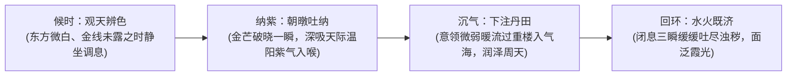

# 朝阳功

#九州 #功法 #导引 #吐纳 #基础

[[世界背景]] [[修士境界]] [[业]] [[师皇学宫]] [[州城法网]]

## 概述

在九州广袤万里的崇山峻岭、城关书院以及寻常田埂墟落之上，每逢黎明将至、东方欲晓之时，总能见到无数初入修途的少年、苍颜老卒乃至未曾得传无上秘典的草泽散修，面朝天际破晓之微茫，端坐磐石吞吐晨曦。其吸气悠长深沉，呼气微细如丝，面庞隐隐泛起一层淡淡紫红交织的温润朝霞。这门在九州流传最为深远、几乎成为天下行气之母法的吐纳法门，便是[[朝阳功]]。

此诀在九州各大道统谱系中，向来被公认为“夺天地晨昏极气以固肉身丹田”的至正之法。名门仙宗称其为“紫气东来诀”，民间散修与乡野塾师亦称其为“导引术”或“吐纳桩”。修者无需借助昂贵稀缺的灵石丹砂，亦不贪图一日千里的暴烈激进，唯于日出日落阴阳交替的转瞬之间，引天边微茫纯阳紫气自鼻窍入膻中、沉气海、过尾闾、贯百会，周而复始。它是九州生民在天地灵机被仙阀层层截留割裂的残酷世道里，唯一能够不假外求、向浩荡天地公平索取的最初生机。

## 核心法则

### 夺天地晨昏交泰之气
天地阴阳互易，莫过于平旦日出与暮霭黄昏。平旦之际，残存夜煞未退，初生朝阳破晓，天地间孕生出一缕至精至纯、温和而不燥烈的极阳紫气。此法专于此天地大交泰之时开阖气窍引气归元。

### 意存丹田而不滞
凡行气导引，最忌以神识死死拘役气流。此诀讲究“如水归壑、似风过林”，施术者意念虚悬于下丹田关元穴，气机顺经络自然流转，遇阻不强冲，功到自然成，使形脉与意脉始终保持最温和之实时对流。

### 阴阳自平无偏枯
孤阳不长，独阴不生。晨起采朝阳紫气以壮肉身气血之生发，暮落吐胸中浊气以顺太阴沉降之安详。日夕配合，周天内景无火毒淤积，亦无阴寒痹阻，筑就万古长青之无瑕道基。

## 法统与术源

溯其源流，此导引诀乃是九州人皇时代以前、先民仰观天象日月运转而自然开创之大道根柢。

太古岁月，天地本无后世层层加锁之玄奥经卷，先民于长夜受尽严寒冻馁与恶疾折磨，每逢朝阳升起，万物复苏，老幼皆本能迎日舒臂展体、大口呼吸天地初开之暖气，渐觉周身经络舒泰、百病不生。后经[[师皇学宫]]前代圣贤爬梳整理，去其粗粝吐纳，结合人身经脉阴阳顺逆之势，定下了“十六字呼吸吐纳真规”，并由古圣王下令摹刻于九州各处名山巨石之上，公之于天下万民，任人观摩传习。

迨至中古之后，[[修仙门阀]]割据名山，将各大高深功法尽数收缴入深阁密锁，垄断修行进阶之天堑。唯独这路刻于山岩、流于市井的[[朝阳功]]，因其“人人可习、见效平缓、无秘法机巧”，反倒历经万载兵燹沧桑而从未失传。从[[帝阙]]深宫的金衣世子，到边陲荒村的孤苦幼童，千百万人皆是依凭这缕同一片朝阳下的紫霞，踏出了求索仙道的第一步。

## 施术原理与行法次第

行法之时，施术者须身着素衣，解开束带，盘膝端坐于地脉开阔之处。

行法初阶为“候时观天”：黎明破晓前一刻，修者敛神止念，舌抵上腭，双目微合注视东方地平线。待到远山天际现出第一缕极细微之红晕、金轮尚未跃出之时，周身毛窍自然舒张；
行法中阶为“纳气入海”：晨光初破一瞬，修者鼻窍长吸，将天边那抹不可多得的微红紫气深吸入体。暖流自鼻窍下行入膻中，宛如一线温水浇入干涸古井，顺督脉直下尾闾，再由任脉回环上升；
行法收势为“洗髓还虚”：气机于周天运转一周，化为精纯之甘露津液涌上舌尖，徐徐咽下入腹，随之口吐极细浊气，浑身骨节暖洋如沐春阳，神清气爽。

## 入门条件与修持代价

### 适修之人
天下凡俗生灵皆可修行。无论根骨高低、资质愚钝或是天生残疾，只要心性能耐住十年如一日起早贪黑之枯燥清寒，皆可借此功打熬出一身浑厚绵长之根基。

### 难成之人
贪恋锦褥温存、昼夜颠倒颠狂之徒；或心浮气躁、妄图三月之内飞天遁地之急功近利之辈，绝难在此诀中窥见半分神异。

### 修持代价
此乃天地间罕见“全无剧烈反噬”之至正王道法门。若硬言其代价，唯在“日久耗功、机缘难速”。施术者必须每日守候那不过半炷香的破晓刹那，若遇连绵阴雨或浓厚瘴气遮蔽天日，便无法采纳纯阳真意；且进境极其平缓，需经年累月水磨工夫方能显现体魄之坚韧。

## 境界尺度与威能演进

- **炼气境界**：可驱散凡胎体内郁结之寒湿病气，令筋骨强健、目力清明，于丹田中孕育出第一滴如针尖般微小却精纯凝练的真元火种；
- **筑基境界**：真气如溪流汇聚成江，呼吸之间引动体表泛起淡淡霞光，能在长途奔波或苦战之后迅速借日出之势恢复大半亏空真气；
- **金丹境界**：达至“天人同息”之极高妙境。坐忘之时，自身呼吸完全与天地晨昏之律动相合，举手投足内蕴浩荡纯阳真意，不惧寻常阴毒尸煞侵袭。

## 现实用途与治理秩序

此诀在九州各大州城的[[州城法网]]监察名册中，属于官署公开鼓励传习之“良民教化之法”。

地方官学与乡野私塾，每日清晨必击云板聚拢学童齐诵导引诀，以此增强生民体魄、抵御偶发之轻微山岚疫病。然而各大[[修仙门阀]]亦心知肚明，单凭此诀平缓之进境，寻常黔首穷尽一生亦难突破至筑基中期，根本无法对世族垄断的高阶法统构成实质威胁。正因其“安全无害且能增强劳役产出”，此法方能超然于各大政治倾轧之外，成为贯通九州仙凡两界的共同语言。

## 反噬、破绽与崩坏裂痕

此法虽正，亦有行差踏错之凶险。

最大之禁忌在于“误采烈日焦煞”：若修者贪功恋功，在红日彻底跃出地表、天光化为暴烈焦金之后仍强行贪婪吞吐，非但采不得温润紫气，反而引动大日燥火灼伤双目视网，导致肺络焦干咳血；此外，若在深陷浓重[[仙凡瘴]]的极煞阴穴中盲目行功，误引死气入脑，反致经络瘫痪。

## 结语

九州仙史万古流传，多少惊才绝艳的魔道巨擘、盖世魔功如流星划过夜空，喧嚣一时却终归化作枯骨尘埃。

唯有这路被高门贵胄视作寻常尘埃的朝阳吐纳，在每一个严寒风霜褪去的黎明，继续无声地唤醒着广袤大地上的千门万户。它是天道留给芸芸众生最朴素的一道公平：任凭人间权柄如何翻云覆雨，只要天边那一轮大日依旧升起，阳光便分毫不差地、温热地照在每一个仰望长空的凡人脸上。

## 相关法术导航

- 母法渊源：[[世界背景]]（天地未分仙凡时之至真源流）
- 衍生法术：[[铁杖身法]]（依托其深厚内息爆发之遁法）
- 关联法统：[[师皇学宫]]（正统道德教化与典章流布之圣地）