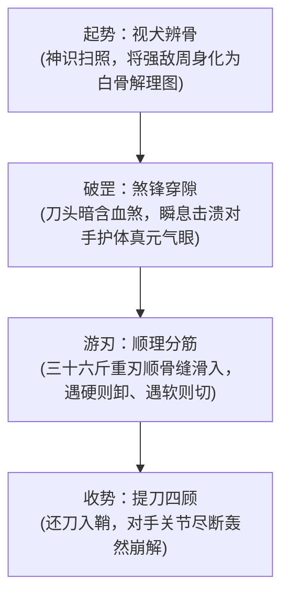

# 解牛刀法

#九州 #法术 #刀法 #武道 #散修

[[世界背景]] [[解牛刀]] [[连山盟]] [[修士境界]] [[业]]

## 概述

在九州边陲重镇的牛马大市、猎兽围场以及屠宰各类凶兽的血腥肉肆之中，常有身穿油腻皮围裙、双掌布满厚茧的粗豪屠子，手持一柄两尺沉重煞刃，面对重逾万斤、皮糙肉厚的庞大荒原异兽，甚至无需催动炽烈真元，唯见其刀锋在兽身周围闲庭信步般游走数息，伴随几声极轻微的筋骨分离脆响，一头巨兽便在转瞬间化作整齐骨架与块块净肉。这门由杀生剔骨之贱役中淬炼而出的极致杀伐武道，便是[[解牛刀法]]。

此法在九州繁复浩瀚的仙法典籍中毫无记载，各大仙宗世族甚至不屑将其录入武经，斥其为“屠猪宰狗之市井浊技”。然而在[[连山盟]]的草泽游侠与底层亡命之徒眼中，它却是一门专破名门护体罡气、以凡屠之力逆斩仙修的近身绝命刀诀。市井散修多称其为“解牛十三刀”、“分筋绝命术”或“庖丁神刃”。当披坚执锐的城关武卒或自恃法宝坚固的名门世子步步紧逼之时，持刀者顺应天地万物骨骼筋脉之微细缝隙挥刃而入，刀锋过处，筋断骨离，如切虚空。它是微末贱民日夜与腥风血雨相搏、在生死夹缝中生生摸索出的屠仙之技。

## 核心法则

### 以形顺理
万物受生于天地，其骨骼皮肉无论淬炼得如何坚硬如铁，其形脉之间必有生就的天然解理与关节缝隙。此刀法不求以刚克刚，核心全在于“顺理而入”，刀刃永远只游走于关节软骨与筋膜交接的至虚之地。

### 刀走空隙
以无厚之刃入有间之节，恢恢乎其于游刃必有余地。施术者神意高度凝练，将对手身躯在眼中直接化作一张清晰通透的白骨骨骼图谱，刀锋不与骨争硬，只在缝隙处轻挑微卸。

### 煞气开道
凡修者必有护体罡气抵御外物。此刀法配合如[[解牛刀]]这等积年凶器，在刀尖接触目标的千分之一刹那，借刀体深锁的兽血凶煞先行撕开护体真元的气机回环，随之引导实体刀锋穿隙而入。

## 法统与术源

溯其源流，此刀法之根本本是古九州农耕与游牧交错地带的屠牲手艺。

古时大荒荒原蛮牛四野横行，体大如丘，凡人难猎更难解剖。先秦时代便有大宗匠庖丁者，以十九年不磨之刃解数千头全牛，手之所触、肩之所倚、足之所履、膝之所踦，莫不中音合拍。彼时此术尚是顺应天道物性之至高哲学与民生技艺。然而迨至中古混战、藩镇割据，天下严苛推行铁禁与农税，底层生民被盘剥得无立锥之地，逃入山林的猎户与屠夫为求自保，遂将这套解牛之术转用于人身拼杀。

他们发现，修士虽然开辟周天、体内真元滚滚，但其肉身骨骼关节之构造，与凡俗走兽并无本质不同。后经[[连山盟]]初代长老、一位退隐老屠夫潜心三十载整理，将原本用于屠宰的四十八式动作，精炼为直取周身要害关节的“十三刀解体绝技”。这柄原本只在案板前分肉的菜刀，自此蜕变成为让各州城关捕快与仙门甲兵闻风丧胆的夺命凶兵。

## 施术原理与行法次第

行法之时，施术者神意古井不波，视眼前强敌如待宰之牲畜。

行法初阶名为“视物辨骨”：持刀者在逼近对手的数丈之内，双眸微敛，神识扫过目标周身，剥离其外在锦衣华服与法力光华，眼中唯见其颈椎、肩胛、肘节与膝盖之骨骼走势，判定其下刀之第一空隙；
行法中阶名为“破罡分筋”：施术者沉身疾进，手中煞刃不劈坚硬胸甲，而是斜向直刺手腕或肘部滑囊。刀尖煞气先声夺人崩解气盾，紧接着厚刃如泥鳅般滑入关节骨缝，借前冲惯性轻轻一绞，韧带立断，握剑之臂当场脱臼软垂；
收势名为“提刀四顾”：十三刀连环如泼风暴雨，刀刃在强敌周身九大关键骨节处瞬息滑过。待施术者收刀还鞘、傲然伫立之时，对手体内骨骼已被全数拆解离位，整个人如散架的皮囊般轰然瘫软于地。

## 入门条件与修持代价

### 适修之人
胆识极其沉凝、见惯血腥屠戮而不眨眼者，或常年在屠肆、矿山行解剖碎骨之苦役，对生灵筋肉骨骼了如指掌的健硕之辈。

### 难成之人
心存妇人之仁、遇血手抖心慌之徒绝难入门；惯于高空御剑远攻、不喜贴身肉搏之羽衣修士，修行此法极易在近身接战时被对手暴烈掌力当场震碎心脉。

### 修持代价
此乃极端凶厉之贴身杀法。施刀者必须将自身置于敌我仅距半步之绝对险境，稍有差池便受刀剑当胸之祸；且长年与兽骨煞刃为伍，杀生太甚，凶戾之气深入骨髓，持刀之人晚年常受恶梦缠身，气血衰败后多患周身骨节刺痛变黑之“煞尸毒”。

## 境界尺度与威能演进

- **炼气境界**：熟谙人体与走兽凡骨解理，出刀干净利落，能在数息内卸脱凡俗披甲重卒之四肢关节，可于近身搏杀中克制数名同阶修士；
- **筑基境界**：可将体内真气微细灌入刃尖，化为半寸吞吐不定之“解骨气芒”，即便面对服食灵药、肉身已初步铜皮铁骨的体修，亦能顺其气血运转盲区强行切断其经筋连系；
- **金丹境界**：达至“目无全牛”之无上通神之境。挥刀之时，刀意自生空间割裂之奇效，数丈之外虚空一划，强敌体内骨骼与经脉便自行生出顺理错位之撕扯感，举手投足尽是造化生克之威。

## 现实用途与治理秩序

此法在九州各州城的正规武官选拔中被明令禁绝，任何武生若敢在擂台之上施展解骨之术，立被削去名籍废黜修为。

然而在[[连山盟]]所辖的数千处黑道堂口与边境走私走廊中，该刀法却是每一位堂口金牌红棍必须精研的立威秘技。各州矿坑发生暴乱或缉捕大案之时，许多出身名门、高傲跋扈的督察法官，皆在此刀之下吃尽苦头。正因其具备以弱胜强、以凡铁剖真元的极简凶悍，各大豪强家族暗地里亦偷偷招揽精通此术的退役屠夫，充作贴身死士与暗杀刺客。

## 反噬、破绽与崩坏裂痕

此法最致命之死穴，在于其“对无形无质之物毫无作为”。

若遭遇精通幽冥幻术、神魂离体夺舍的阴鬼修士，或是面对不具骨骼经络之无定形泥怪、元素精怪，[[解牛刀法]]便完全失去施力目标，游刃无间之能荡然无存；且此法长年杀戮，施刀者身上所背负之深沉[[业]]痕无法自消，每每在冲击高阶金丹心魔大劫之时，万千被其屠宰肢解之生灵残魂便化作血海幻象回涌反噬，导致施术者走火入魔、神魂爆裂而亡。

## 结语

九州仙门崇尚高远空灵之太上忘情，视屠夫庖丁为凡尘最下等之贱役。

然而，这套在最卑微、最污秽的血水肉案前磨砺而成的解牛之刃，却以其最质朴的顺理之道，冷酷地嘲讽着一切自诩高高在上的虚妄金身。它告诉每一个握刀前行的微末凡躯：世间看似坚不可摧的森严铁壁，在其看不见的骨缝与经络深处，早已布满了等待顺理切开的巨大裂痕。

## 相关法术导航

- 配套器物：[[解牛刀]]（施术之本命三十六斤百炼煞刀）
- 关联法理：[[业]]（阐明杀生积怨反噬灵台之心魔渊源）
- 关联势力：[[连山盟]]（技击源流汇聚与实战演化之江湖大纛）