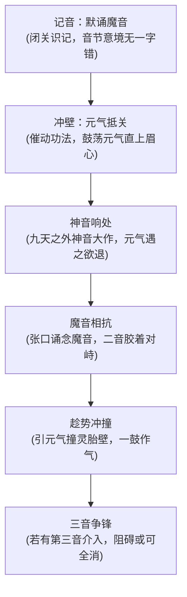

# 双音争锋·神魔真言

#九州 #法术 #真言 #神族

[[灵胎神藏]] [[霸体三丹功]] [[心澜诀]] [[天弧]] [[业]]

## 概述

大荒古传所载的异术之中，再没有比神魔真言更诡异、更犯忌、也更诱人的一门了。

此术一式两音，同源相杀：一式曰**神音**，自九天之外垂落，庄严神圣，如高天神明诵经，闻之则心神畏服、元气立退；一式曰**魔音**，自大荒深渊涌出，诡谲磅礴，如亿万魔神呐喊，闻之则气血翻涌、几不自持。两音本是不共戴天的死敌，亘古以来相互攻伐，可在某些绝险的关口，偏偏是这两道死敌之声的相互胶着，为凡俗修者撞开了一道缝——冲壁破关、临危翻盘，皆在此一瞬。

也正因这一线可乘之机，神魔真言自问世起便背着双重骂名：习魔音者，被斥为"魔头蛊惑人心"；借魔音破神音者，更被坐实了"被神封印的魔"这等恶名。此术是左道中的左道，偏方中的偏方，却是凡躯破壁传说里最惊心动魄的一页。

## 核心法则

### 音为法旨

此术不藉符箓、不藉印诀、不藉法器，音节本身即是法旨。神音魔音每一个起伏转折，都直接叩在听闻者的意脉之上——神音之庄严，能令元气不战自退；魔音之诡谲，能令气血不召自沸。所谓真言，言出而法随，介质唯有人耳与识海。

### 相争相济

两音对峙，则神音的锁系之力被魔音抵住，灵胎壁前的阻碍骤然松脱。此术全部妙用，皆着落在这个"争"字上：不是借魔音破关，而是借两音相争时那一线空隙，令自家元气趁势冲撞。故行此术者，须如走索人一般，精准地踩在两道灭顶巨浪的夹缝之间。

### 神魔之辨

神与魔在此术中本无道义，只有位阶与锁系。然而世人不管这些——谁的口中诵出魔音，谁便自动落入"魔"的字眼。此术第三条铁律由此而生：行法者须先有赴死的觉悟，或赴肉身之死，或赴名分之死。

## 法统与术源

神魔真言的源流，是一桩说不清道不明的古案。

**神音一支**，古传归诸九天之上的神谕。其气质与神族[[天弧]]一脉的真言隐隐相通——同样的庄严，同样的不容置疑，同样带着锁系与定序的意味；[[心澜诀]]一路的佛门空照之法，于此道外人观之，亦有几分遥远的呼应。大荒野老据此断言：破壁之际阻关的那道神音，本就是高天为断凡俗登进而设的禁制。此说无从实证，却与[[灵胎神藏]]篇所载的诸多疑团暗暗相合。

**魔音一支**，则出大荒深渊的古魔遗咏。按遗迹出土的残图所示，万古之前，魔音与神音在峡谷废墟之上年复一年地对峙，夜夜相杀，谁也不曾彻底压服对方；白日鸡啼、阳光破晓之际，黑暗如潮水退去，魔音也随之退向地平线。有野史家据此推测：魔音是被神音镇压的余烬，镇压愈久，其声愈烈——正如炭盆之上的灰，压得愈实，底下的火愈不肯熄。

两音孰先孰后、孰正孰邪，古传无一字定论。可以确定的只有一事：此术的雏形，源于某位大荒修士于峡谷遗迹之中，将两音的音调节奏日夜默记于心，又在破壁的绝境中，鬼使神差地将它们摆到了同一个识海里。

## 施术原理与行法次第

行此术者，先须经年累月地"记音"——将魔音的高低起伏、抑扬顿挫、语气转折、意境音节、音色微芒，一一默记，直到闭目可闻、张口即来，错不得一个字节。记音既成，方谈得上行法。

行法之初阶名为"对音"：修者于静处自诵魔音，辨其每一处转折与神音的对应，如琴师调弦，差之毫厘，则对峙不成，反受其乱。

行法之中阶名为"借争"：冲壁之际，神音响处即诵魔音，须不早不晚——早则神音未起，魔音徒然扰乱自家识海；晚则元气已退，冲壁之势溃散。二音胶着的一线空隙，短如电光石火，全凭修者死死咬住。

行法之极境名为"三音争锋"：古传记载，若有第三道音律介入神魔之争，三音互斫，阻碍或可全消。大荒古村曾有一位少年，于破壁绝境中引得第三音介入，一举功成。此中关节，后人千般模仿，无一得之——是运气，是资质，还是古传另有未载的关窍，至今无人能答。

## 入门条件与修持代价

### 适修之人

- 记性绝佳、音感通神者。魔音音节拗口，意境诡谲，记错一字，前功尽弃。
- 胆大包天、于绝境中犹能守住一线清明者。此术行法之际如在万丈深渊上走索，心怯者当场气机逆冲。
- 已有元气根基者。未曾引气入体之人，纵诵烂真言，也无关可冲。

### 难成之人

- 根基浅薄、识海未固者。神魔之音的余波入梦，便能令其神魂颠倒，重则痰迷心窍。
- 心性摇摆、随人言而迁者。此术背负"魔"之恶名，修习途中时时听闻诛心之论，志不坚者半途而废犹算幸运。
- 声名显赫、门户森严的宗门嫡传。纵有胆识，也担不起"通魔"的罪状。

### 修持代价

此术的代价，一半在神魂，一半在名分。

神魂之损：神魔之音一旦入识，便如两道戾气长驻。夜半入梦，识海中黑暗与光明相互厮杀，亿万魔神与金甲神明混战，修者"站"在厮杀上空，动弹不得，天明方醒，一身冷汗，神魂如遭车轮辗过。久行此术而不调摄者，日渐形容枯槁，神魂颠倒。

名分之危：一旦被人察觉口诵魔音，"魔"字便如烙印加身。古往今来，死于这道名分之下的修者，比死于音波反噬的更多。借魔音破了壁的，尚可辩称"破壁权宜"；借魔音杀了人的，纵有天大的道理，也逃不过一个"魔"字。

## 境界尺度与威能演进

- **炼气境界**：初记音节，勉强自诵。此时真言尚不能外放，仅能于自家识海中与神音做短促对峙，于冲壁之助微乎其微，且稍有不慎便遭音波反噬，头痛欲裂。
- **筑基境界**：音节渐熟，二音可对峙旬月。此阶行法，于破壁之助堪称脱胎换骨——神音响处，魔音起而相抗，元气趁势冲撞，成算较之硬撞高出数倍。真言亦可勉强外放，扰敌气机，令对手气血一滞。
- **金丹境界**：真言彻外，音律自成领域。一声诵出，数丈之内，敌方元气亦可受其激荡；心志不坚者闻魔音而气血偾张，闻神音而心神畏服。此阶行法，已不必假借灵胎壁，两音对峙本身即是杀伐。
- **元婴以上**：古传讳莫如深，只留下一句"音出而神魔动"，详情无人得见。或因此境修者一言可动天地，已不容此术轻售；又因此术至此，行法者与所诵之音之间的界限，早已模糊难辨。

## 现实用途与治理秩序

此术在世间的位置，尴尬得近乎可笑。

一方面，它是公认的犯禁之术。州府律令与仙门戒条，皆将私习魔音列为"通魔大罪"，查获即焚其卷、废其修；各城[[州城法网]]对音波异常多有留印，一经比对，立成铁证。另一方面，大荒深处与黑市暗道之中，神魔真言的残卷始终暗流涌动——欲行险破壁的凡躯、走投无路的死囚、别无所长的散修，宁可背着"魔"名，也要换这一线破关的成算。[[连山盟]]辖下的几处暗坊，常年有这门偏方的抄本流转，价比寻常功法贵出十倍，买主却从未断过。

仙门对此术的态度则是彻底的傲慢：不承认它是术，只承认它是罪。

## 反噬、破绽与崩坏裂痕

此术的破绽，深得让人不愿直视。

**一、药不对症之险**。遗迹神女所诵神音与破壁之际的阻关神音，形似而神异；以对抗前者之魔音去对抗后者，本是病急乱投医。神音魔音一旦生出古传未载的诡异变化，丢掉的便不是一条性命那么便宜——魂飞魄散，万年修行付诸流水。古村那位少年能活下来，半靠胆气，半靠一件来历不明的护身异宝，此节无从复制。

**二、名分之狱**。此术最致命的杀招从不在音波，而在人言。一旦"通魔"的名目坐实，天下共击，任你三丹圆满、真言彻外，也逃不过宗门的围剿与法网的绞索。

**三、形意深痕**。神魔之力，本非凡物。借真言强行撬动超越自身的伟力，每一次都在天地形意之间刻下深重的[[业]]痕——古传所谓"凡人觊觎神魔的力量，只有死路一条"，说的不仅是当场之死，更是这笔迟早要还的债。

**四、两音相争的不可控**。对峙之隙短如电光，此术的全部妙用系于一线；线上是生门，线外是悬崖。自古以来，以此术冲壁而气机逆冲、识海崩解者，十人之中不下三人。

## 结语

神魔真言是天地开的一个残酷玩笑：它把锁系的钥匙，交给了被锁者的死敌。

高天的神音锁死了凡俗的登进之门，深渊的魔音被这门锁了万古；两股谁也不服谁的力量撞在一处，反倒为夹缝中的凡胎挣得了一线喘息。此术在整座天地间的座标，说来近乎讽刺——它是邪魔外道的不二铁证，也是微末凡躯最惊心动魄的捷径。走与不走，千古以还，没有几人舍得说不。

## 相关法术导航

- 母法与关窍：[[灵胎神藏]]（神音锁藏与破壁之机的法理根基）、[[霸体三丹功]]（冲关蓄势的行功搭档）
- 同源旁支：[[心澜诀]]（佛门真言一路的空照之法，气质与神音遥通）
- 上位关联：[[天弧]]（神族真言一脉的锁系法统）
- 法理代价：[[业]]（觊觎神魔之力的形意深痕）
